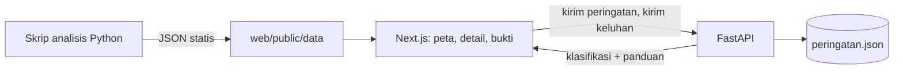

# 03 — ARCHITECTURE & Rencana Build

> Turunan dari 01-PRD. Prioritas: alur inti jalan stabil. ID task = ID di 04-TODO.

## 1. Stack
| Lapisan | Pilihan | Alasan |
|---|---|---|
| Web | Next.js (App Router, TypeScript, Tailwind v4) | Dikuasai tim [dari user]; deploy gratis di Vercel |
| API | Python 3.13 + FastAPI | Model AI dan analisis data ada di Python; satu bahasa untuk ML |
| Analisis offline | Python: numpy, pandas, scikit-learn, rasterio, blackmarblepy | Olah satelit, raster, simulasi dan pelatihan model; hasil diekspor ke JSON statis |
| Database | Tidak ada. Data contoh dan hasil analisis = JSON statis di `web/public/data/`; peringatan dan percakapan = penyimpanan di memori API + berkas JSON | Purwarupa TKT 3, tanpa data pengguna nyata (YAGNI) |
| Auth | Tidak perlu. Pilih peran tanpa sandi, disimpan di cookie | [dari user] |
| AI | Model lokal scikit-learn (klasifikasi keluhan, prediksi baterai) + deteksi anomali statistik | Gratis, tanpa API key, bisa dievaluasi, jalan offline [dari user] |
| Komponen UI | Template Soft Op Dashboard (`starter/`): kelas CSS + shell sendiri, **tanpa shadcn, tanpa sidebar-21st, tanpa framer-motion** | Template dipilih user; lihat Q&A Q2 |
| Peta | MapLibre GL JS + ubin OpenStreetMap | Sumber terbuka, tanpa biaya lisensi |
| Visualisasi data | SVG buatan sendiri (deret waktu, batang) | Grafik sedikit dan sederhana; hindari dependency |
| Ikon | lucide-react (stroke 1.75) | Bawaan template; bukan emoji |
| Hosting | Web: Vercel. API: Render free tier | Gratis; hasil berat statis supaya demo tidak bergantung pada API yang "tidur" |

## 2. Perintah Verifikasi & Setup
| Cek | Perintah |
|---|---|
| Install web | `cd web && npm install` |
| Install API/analisis | `cd api && python -m venv .venv && .venv/Scripts/pip install -r requirements.txt` (analisis: sama di `analisis/`) |
| Dev web | `cd web && npm run dev` |
| Dev API | `cd api && .venv/Scripts/uvicorn app.main:app --reload` |
| Hasilkan data | `cd analisis && .venv/Scripts/python -m plts` (data PLTS + kunci desa uji), `-m baterai.latih`, `-m cahaya_malam.unduh`, `-m cahaya_malam.analisis`, `-m lokasi.unduh`, `-m lokasi.estimasi` (keluaran ke `web/public/data/`) |
| Test web | `cd web && npm test` (vitest) |
| Test Python | `cd api && .venv/Scripts/pytest -q` · `cd analisis && .venv/Scripts/pytest -q` |
| Build | `cd web && npm run build` |
| Typecheck | `cd web && npx tsc --noEmit` |
| Lint | `cd web && npm run lint` · `ruff check api analisis` |
| Dead code | `cd web && npx knip` · `vulture api analisis --min-confidence 80` |
| Eval AI | `cd api && .venv/Scripts/python -m eval.keluhan` (akurasi per kategori) · `cd analisis && .venv/Scripts/python -m baterai.latih` (latih + evaluasi deterministik) |
| Alur inti | Manual: jalankan web + API, ikuti 6 langkah 01-PRD §4 di 1440 dan 375 |

## 3. Model Data
| Entitas | Field kunci | Relasi | Sumber |
|---|---|---|---|
| PLTS | id, nama, desa, kabupaten, koordinat, kapasitas_kwp, baterai_kwh, jumlah_kk, koperasi, status, alasan_status, label_data (asli/contoh) | 1-n DeretCahaya, 1 PrediksiBaterai, 1-n Peringatan | `web/public/data/plts.json` (contoh + lokasi asli terverifikasi) |
| DeretCahaya | plts_id, tanggal, radiansi, kualitas, garis_dasar, skor_z, anomali | n-1 PLTS | Skrip `analisis/cahaya_malam` → `cahaya.json` |
| HasilUjiSatelit | desa, kelompok (mangkrak/pembanding), periode, terdeteksi, ringkasan | - | `cahaya/ringkasan.json` |
| PrediksiBaterai | plts_id, p_gagal_8_minggu, minggu_tersisa, keyakinan, fitur_utama | 1-1 PLTS | `analisis/baterai` → `baterai/prediksi.json` |
| MetrikModel | nama_model, data_uji, recall, presisi, mae_minggu, uji_silang | - | `baterai/metrik.json`, `api/eval/hasil.json` |
| CalonLokasi | id, nama, koordinat, penduduk, kk, kebutuhan, panel_kwp, baterai_kwh, waktu_tempuh, anggaran p10/p50/p90, biaya_rp_kwh, risiko, alasan, keputusan | - | `analisis/lokasi/estimasi.py` → `web/public/data/lokasi.json` |
| Peringatan | id, plts_id, dibuat, status (terkirim/dibaca/ditangani/selesai/eskalasi), kategori, keyakinan | n-1 PLTS, 1-1 Percakapan | API (memori + `api/data/peringatan.json`) |
| Pesan | id, percakapan_id, pengirim (sistem/operator/asisten), teks, waktu, klasifikasi | n-1 Percakapan | API |
| TopikPanduan | kategori, judul, langkah[], tingkat_bahaya, wajib_teknisi | - | `api/data/panduan.json` (ditinjau teknisi listrik) |

**Desa uji satelit (dikunci 30 Okt 2026 di `analisis/cahaya_malam/desa_uji.json` sebelum data dilihat; koordinat dari OpenStreetMap Nominatim, titik pusat pulau/desa):**
| Desa | Kelompok | Sumber kasus |
|---|---|---|
| Dusun Parang, Karimunjawa, Jepara | mangkrak sejak 2019 | detik.com, 12 Mar 2022 |
| Desa Lakarama, Kec. Towea, Kab. Muna, Sulawesi Tenggara | mangkrak sekitar 5 tahun (baterai rusak), 100 kWp | Antara Sultra, 24 Jan 2025 |
| Pulau Burung Loe (Pulau Buhung Pitue), Sinjai | mangkrak sejak 2018, 100 kWp | Mongabay, 16 Okt 2020 |
| Pulau Sembur, Batam | pembanding: PLTS baru Des 2025 | Listrik Indonesia, 2025 |
| Desa Batu Bingkung, Kab. Kepulauan Selayar | pembanding: 150 kWp, menyala 24 jam setelah perbaikan | Warta Ekonomi, 5 Feb 2022 |

## 4. Integrasi & Alur Sistem
- **Integrasi pihak ketiga:**
  - NASA Black Marble VNP46A2 lewat `blackmarblepy`: butuh token Earthdata (didaftarkan tim, disimpan di `analisis/.env`, tidak di-commit). Data harian sejak 2012, resolusi 15 detik busur.
  - Global Solar Atlas (GeoTIFF PVOUT Indonesia), peta waktu tempuh Weiss dkk. (2018), OpenStreetMap (jaringan listrik, jalan): unduh sekali, simpan di `analisis/data/` (di-.gitignore bila besar).
  - Ubin peta OpenStreetMap untuk MapLibre (patuhi atribusi dan kebijakan pemakaian ubin).
- **Alur sistem:**

- **Keamanan & privasi dasar:**
  - Tidak ada data pribadi; nama operator/koperasi di data contoh adalah fiktif berlabel "contoh", kecuali nama tempat publik.
  - Validasi input keluhan di API (panjang maks 500 karakter, teks saja) dengan Pydantic.
  - CORS API hanya mengizinkan domain web.
  - Token Earthdata hanya di `.env` lokal; `.env.example` tanpa nilai.

## 5. Peta Panggilan AI *(pola: `docs/AI-PRIMITIVES.md`)*
> AI dipanggil kode sebagai primitif kecil; kode yang memutuskan. Semua model lokal, tanpa layanan luar.

| Titik keputusan | Primitif | Input (JSON) | Output | Ambang: otomatis / review / buang | Eskalasi |
|---|---|---|---|---|---|
| Baterai mencapai akhir umur dalam 26 minggu | ya/tidak + p, dan score minggu_tersisa (batas 104) | `{soh_bms, tren_soh, proyeksi_minggu}` | `{p, minggu_tersisa}` | p ≥ 0,9 kritis / 0,7-0,9 waspada / 0,5-0,7 "perlu dicek" tanpa peringatan / < 0,5 normal | Pengawas memutuskan kirim peringatan |
| Dugaan padam (cahaya malam) | ya/tidak + skor-z | `{deret: [radiansi, kualitas], garis_dasar}` | `{anomali, skor_z, malam_berturut}` | z ≤ -3 dan ≥ 5 malam berkualitas berturut → kritis; selain itu normal | Bila PLTS juga punya data baterai normal, status "perlu konfirmasi lapangan" |
| Kategori keluhan | choice + p | `{teks}` | `{kategori, p, kandidat_kedua}` | p ≥ 0,8 panduan / 0,5-0,8 konfirmasi dua kandidat / < 0,5 teknisi | Kategori bertanda `wajib_teknisi` selalu ke teknisi |

- **Penyedia:** scikit-learn (TF-IDF + regresi logistik untuk keluhan; gradient boosting untuk baterai). Tidak ada LLM. Fallback: bila API tidak tersedia, P13 menampilkan daftar kategori untuk dipilih manual.
- **Diolah saat data masuk vs saat ditanya:** prediksi baterai, deret cahaya malam, dan skor lokasi dihitung offline lalu disimpan statis; hanya klasifikasi keluhan yang dihitung saat ditanya.
- **Ambang disimpan di:** `api/app/config.py` dan `web/src/lib/ambang.ts` (sama nilainya, diuji), bukan di prompt. Ambang keluhan hanya di `config.py`: web menampilkan `keputusan` dari API, tidak menghitung ulang. Keluhan yang memuat kata bahaya (`KATA_BAHAYA`: asap, terbakar, percikan, kesetrum, gosong, menggembung, dst.) selalu ke teknisi, apa pun kategorinya.
- **Versi dikunci:** model baterai disimpan berversi (`baterai-v2.joblib`) + hash data latih di `metrik.json`. Model keluhan (149 kalimat latih) dilatih ulang saat API mulai dari `api/data/keluhan_latih.csv` (deterministik, tanpa berkas pickle); hash data latih dicatat di `api/eval/hasil.json`.
- **Eval:**
  - Keluhan: 60 contoh berlabel di `api/eval/keluhan.csv` (bahasa sehari-hari, variasi ejaan); target akurasi ≥ 0,85 [asumsi]; uji robustness: huruf besar/kecil dan tanda baca diubah → kategori sama. Hasil T12 (31 Okt 2026, keluhan-v1, C=100 dipilih lewat validasi silang data latih saja): akurasi 0,95 (57/60), dua teratas 0,983; per kategori baterai 0,9, kabel 0,8, sisanya 1,0; robustness 60/60. Cabang: 41 panduan (akurasi 1,0), 8 konfirmasi (0,875), 11 teknisi. Data latih dan eval ditulis tim, bukan pesan operator asli, jadi angka ini batas atas; wajib diuji ulang dengan pesan lapangan.
  - Cahaya malam (T7, 31 Okt 2026): kelima desa uji berstatus sinyal lemah (garis dasar 2015-2016 0,00-0,15 nW/cm²/sr, ambang 0,5); desa pembanding yang menyala sama redupnya dengan desa mangkrak. Kesimpulan: untuk desa 200-400 KK, Black Marble tidak cukup sebagai pendeteksi padam; sesuai mitigasi di Risiko, satelit menjadi indikator pendukung dan status utama dari prediksi baterai.
  - Panel Sentinel-2 (T7b, 31 Okt 2026): Sembur NDVI area panel 0,83 → 0,12 setelah PLTS dibangun Des 2025 (terdeteksi); Parang stabil walau padam, sehingga foto siang hanya untuk kondisi fisik, bukan status padam.
  - Baterai: data uji simulasi terpisah per baterai (tidak bocor antar split); target recall ≥ 0,70 [asumsi]. Model v2 (240 baterai uji simulasi): PR-AUC 0,701; ambang 0,5 recall 0,658 / presisi 0,710; ambang 0,7 recall 0,468 / presisi 0,809 (aus 0,536, mendadak 0,049); MAE minggu tersisa 19,1 minggu. Uji silang (T5) pada 77 sel LFP nyata HUST (Ma dkk., 2022): PR-AUC 0,731 (basis 0,108), recall 0,078 / presisi 1,0 di ambang 0,5 dan 0,7; median p pada sel yang akan aus 0,045, sehingga ambang wajib dikalibrasi dengan data lapangan. Model v1 (dengan suhu, DoD, siklus, umur): PR-AUC simulasi 0,811 tetapi 0,167 di HUST.
- **Biaya & latensi:** Rp0 per panggilan; klasifikasi < 50 ms di CPU.

## 6. Rencana Build
| ID | Milestone | Task | Pemilik | Fitur | Kriteria selesai |
|---|---|---|---|---|---|
| T1 | Fondasi | Repo monorepo `web/ api/ analisis/`, scaffold Next.js + starter Soft Op + token dari 08-DESIGN, FastAPI health-check, tooling (vitest, ruff, pytest, knip, vulture) | Anggota 4 | - | Lint/typecheck/test/build hijau; shell tampil dengan token; `GET /health` 200 |
| T2 | Data | `plts.json`: Parang, Pulau Sembur + PLTS contoh Karimunjawa; verifikasi koordinat dan sumber desa uji §3 | Anggota 3 | F2, F7 | Setiap titik punya sumber atau label "contoh"; desa uji terkunci di `cahaya_malam/desa_uji.json` sebelum unduh data |
| T3 | Baterai | Simulator degradasi baterai dengan parameter dari literatur (sumber dicatat di kode dan P10) | Anggota 1 | F6 | Dataset ≥ 1.000 baterai simulasi; parameter + sumber di `baterai/parameter.py`; test simulator lulus |
| T4 | Baterai | Latih model + split per baterai + metrik + ekspor `prediksi.json`, `metrik.json` | Anggota 1 | F6 | Metrik tercatat di 04-TODO; recall dilaporkan apa adanya |
| T5 | Baterai | Uji silang dataset publik (HUST, `python -m baterai.uji_silang` setelah `baterai.latih`) | Anggota 1 | F6 | Hasil di `metrik.json` bagian `uji_silang`, termasuk bila buruk |
| T6 | Satelit | Skrip unduh Black Marble untuk desa uji (token dari tim) | Anggota 3 | F7 | Data mentah 2015-2026 tersimpan per desa; skrip bisa diulang |
| T7 | Satelit | Garis dasar + deteksi anomali + ekspor `cahaya/*.json` dan `ringkasan.json` | Anggota 3 | F7 | Semua desa uji punya hasil; test fungsi anomali lulus |
| T8 | Web inti | P1 Pilih Peran + nav pengawas/operator di `nav.ts` + placeholder halaman Should/Could | Anggota 2 | F1 | Ganti peran berfungsi; semua rute di PRD §5 terjangkau |
| T9 | Web inti | P2 Peta Pemantauan (MapLibre, metrik, kartu sorotan) | Anggota 2 | F2 | Titik dan metrik dari `plts.json`; state kosong/loading/error; 1440/768/375 |
| T10 | Web inti | P3 Detail PLTS (grafik cahaya malam SVG, prediksi baterai, alasan status) | Anggota 2 | F3 | Data dari JSON; label sumber; state data belum ada |
| T11 | API | Endpoint peringatan (buat, daftar, ubah status) + penyimpanan berkas | Anggota 4 | F4 | Test endpoint lulus; validasi input |
| T12 | AI | Eval set 60 keluhan berlabel + model klasifikasi + skrip akurasi | Anggota 1 | F5, F8 | Akurasi per kategori tercatat; uji robustness lulus |
| T13 | API | Endpoint klasifikasi + panduan + aturan ambang dan eskalasi | Anggota 4 | F5 | Test tiga cabang ambang + kategori wajib teknisi lulus |
| T14 | Web inti | P5 Peringatan + aksi kirim peringatan dari P3 | Anggota 2 | F4 | Status sinkron dengan API |
| T15 | Web operator | P12 Kotak Masuk + P13 Percakapan (jawaban cepat, eskalasi, tandai selesai, fallback API mati) | Anggota 2 | F5 | Alur langkah 5-6 jalan; status P2 berubah |
| T15b | Web operator + API | Laporan malam (F15): pesan harian Ya/Tidak di P12, endpoint simpan jawaban, aturan 2 malam berturut, tanda di P3 | Anggota 2 | F15 | Test aturan dugaan padam; alur jawab di P12 tercermin di P3 |
| T7b | Satelit siang | Deret Sentinel-2 di poligon PLTS (F16) + kartu P3 | Anggota 3 | F16 | Semua PLTS bertitik OSM tampil termasuk yang tidak berubah; test fungsi poligon dan indeks |
| T6b | Eksplorasi | Cek akses SDGSAT-1 Glimmer untuk Parang dan Batu Bingkung (F17) | Anggota 3 | F17 | Tercatat bisa/tidak beserta alasannya |
| T16 | Bukti | P9 Analisis Cahaya Malam + P10 Model Baterai | Anggota 3 | F6, F7 | Semua desa uji tampil termasuk hasil negatif; metrik tampil |
| T17 | Lokasi | Skrip skor Kab. Jepara (PVOUT, kebutuhan, jaringan/PLTD, waktu tempuh; bobot di config) | Anggota 3 | F9 | `lokasi/jepara.json`; test fungsi skor lulus |
| T18 | Lokasi | P7 Perencanaan Lokasi + P8 Rincian | Anggota 2 | F9 | Peta sel + 5 teratas + kontribusi kriteria |
| T19 | Pelengkap | P4 Daftar PLTS, P6 Detail Peringatan, P11 Metodologi, P15/P16 sistem | Anggota 2 | F10, F11 | Semua state; tabel bisa diurutkan |
| T20 | Rilis | Deploy Vercel + Render, warm-up API, uji alur inti online di laptop dan ponsel | Anggota 4 | - | Tautan publik; alur 6 langkah tanpa error |
| T21 | Rilis | Rekam video demo + tangkapan layar untuk proposal (Tabel 3.3) | Ketua | - | Video ≤ 3 menit; status Tabel 3.3 diperbarui dengan bukti |
| T22 | Could | F12 ekspor CSV, F14 filter status, F13 bandingkan lokasi, P14 Panduan, P17 Pengaturan | - | F12-F14 | Sesuai kriteria terima PRD |

## 7. Risiko & Cadangan
| Risiko | Cadangan |
|---|---|
| Sinyal cahaya malam desa kecil terlalu lemah atau tertutup awan | Laporkan apa adanya di P9; lapisan satelit jadi indikator pendukung; status utama dari prediksi baterai |
| Token Earthdata terlambat | Kerjakan T8-T15 dulu; P3 menampilkan state "data satelit belum tersedia" |
| Model baterai dianggap menghafal simulator | Parameter bersumber, split per baterai, uji silang dataset publik, label "simulasi" di semua tampilan |
| API Render tidur saat demo | Hasil berat statis; P13 punya fallback pilih kategori manual; warm-up sebelum demo |
| Data raster lokasi terlalu besar | Potong ke batas Kab. Jepara sebelum diproses; sel 1 km |
| Deadline lebih cepat dari 2 minggu | Potong Should (T17-T19) lebih dulu; Tabel 3.3 diisi "Berjalan" dengan bukti parsial |

## 8. Q&A Keputusan
| # | Pertanyaan | Keputusan | Tanggal |
|---|---|---|---|
| Q1 | Saklar bisnis? | Tidak; model bisnis cukup di proposal | 30 Okt 2026 |
| Q2 | Sumber komponen UI? | Template Soft Op Dashboard: area aplikasi dari `design-templates/soft-ops-dashboard/starter/`, tanpa shadcn dan tanpa sidebar-21st (pengecualian aturan umum sesuai TEMPLATE.md §0) | 30 Okt 2026 |
| Q3 | Database? | Tidak ada; JSON statis + berkas di API untuk demo | 30 Okt 2026 |
| Q4 | AI dari mana? | Model lokal scikit-learn, tanpa LLM; jawaban asisten dari panduan tertulis | 30 Okt 2026 |
| Q5 | Rencana B bila Parang tidak terdeteksi? | Uji desa lain dari daftar yang ditetapkan di muka (§3); semua hasil dilaporkan | 30 Okt 2026 |
| Q6 | Wilayah contoh peta lokasi? | Kab. Jepara (Karimunjawa) | 30 Okt 2026 |
| Q7 | Landing page? | Tidak | 30 Okt 2026 |
| Q9 | Fitur model baterai? | v2: hanya kapasitas BMS, tren, dan proyeksi. v1 (ditambah suhu, DoD, siklus, umur) menghafal laju penuaan simulator dan gagal di sel nyata HUST (PR-AUC 0,167 vs 0,731). Keputusan diambil setelah melihat HUST, jadi HUST bukan lagi uji buta; ditulis terbuka di P10 dan proposal | 30 Okt 2026 |
| Q10 | Lapisan peta P2? | Empat lapisan dengan peran berbeda dan keterangan di peta: OSM (jalan), Esri World Imagery (foto orientasi, "bukan kondisi terkini"), EOxCloudless Sentinel-2 2024 (panel masih ada), NASA GIBS Black Marble 2016 (gambaran cahaya malam; bukti padam tetap dari analisis T7). Proyeksi globe MapLibre. P3 menautkan Copernicus Browser untuk citra terbaru. Lisensi: Esri gratis untuk non-komersial dengan atribusi (resminya dengan akun ArcGIS Developer), EOxCloudless 2024 CC BY-NC-SA 4.0, GIBS terbuka; produksi beralih ke Sentinel-2 Copernicus (bebas komersial) atau lisensi berbayar | 30 Okt 2026 |
| Q11 | Data cahaya malam dan aturan deteksi? | Harian 2015-2026 penuh ±260 GB (3 ubin × ~20 MB × ±4.300 hari), terlalu besar. Diganti VNP46A3 bulanan 2015-sekarang + VNP46A2 harian 90 hari terakhir (±18 GB), dibaca langsung dengan `h5py` (pengganti `blackmarblepy`). Jendela 5×5 piksel di pusat desa. Aturan ditetapkan sebelum data desa uji dilihat: garis dasar = median 2015-2016; anomali = < 50% garis dasar; terdeteksi = ≥ 6 bulan anomali berturut-turut; sinyal lemah = garis dasar < 0,5 nW/cm²/sr [asumsi]; malam gelap = malam cerah < 50% garis dasar. Saringan kualitas bulanan dilonggarkan ke 0-1 setelah melihat satu ubin contoh Januari 2024 (Semarang pun berkualitas 1), sebelum deret desa uji dihitung | 30 Okt 2026 |
| Q12 | Pengganti deteksi padam setelah uji satelit negatif? | Empat sumber bukti (persetujuan user 31 Okt 2026): (1) laporan malam operator di P12 sebagai sinyal padam harian; (2) Sentinel-2 L2A di dalam poligon PLTS OSM lewat Microsoft Planetary Computer (`pystac-client`, `rasterio`) untuk kerusakan fisik; (3) cahaya malam VIIRS tetap ditampilkan sebagai uji yang gagal dan dipakai hanya untuk PLTS/desa besar dan skor lokasi; (4) SDGSAT-1 Glimmer (resolusi ~40 m) sebagai eksplorasi berlabel bila datanya bisa diakses | 31 Okt 2026 |
| Q13 | Peta lokasi diperluas jadi estimasi per permukiman? | Ya (permintaan user 31 Okt 2026): klik permukiman → kebutuhan, ukuran sistem, anggaran Monte Carlo (sebaran ESMAP 2022 × logistik waktu tempuh), biaya Rp/kWh vs bahan bakar genset, risiko mangkrak berbasis aturan (`analisis/lokasi/parameter.py`). Wilayah demo Kab. Maluku Barat Daya (Perpres 63/2020); Jepara batal karena data rumah tangga BPS Jateng tidak bisa diakses. Bukan model latih: data PLTS mangkrak per lokasi belum cukup | 31 Okt 2026 |
| Q14 | Deploy tanpa biaya? | Render dan Hugging Face Spaces kini meminta kartu atau berbayar untuk layanan Python. Purwarupa online = satu deploy Vercel: klasifikasi keluhan di route handler Next.js (`/api/keluhan`, `/api/panduan/[kategori]`) memakai bobot hasil latih scikit-learn yang diekspor `api/ekspor_web.py` (test kesetaraan 60 kalimat eval); peringatan dan laporan malam di penyimpanan browser dengan aturan yang sama (`web/src/lib/aturan.json`). FastAPI tetap untuk latih, eval, dan integrasi tahap lanjut | 31 Okt 2026 |
| Q8 | Horizon prediksi baterai? | 26 minggu, bukan 8: kapasitas LFP turun lebih pelan dari derau BMS sehingga 8 minggu hanya PR-AUC 0,45; 26 minggu PR-AUC 0,811 dan memberi waktu anggaran/pengadaan | 30 Okt 2026 |
